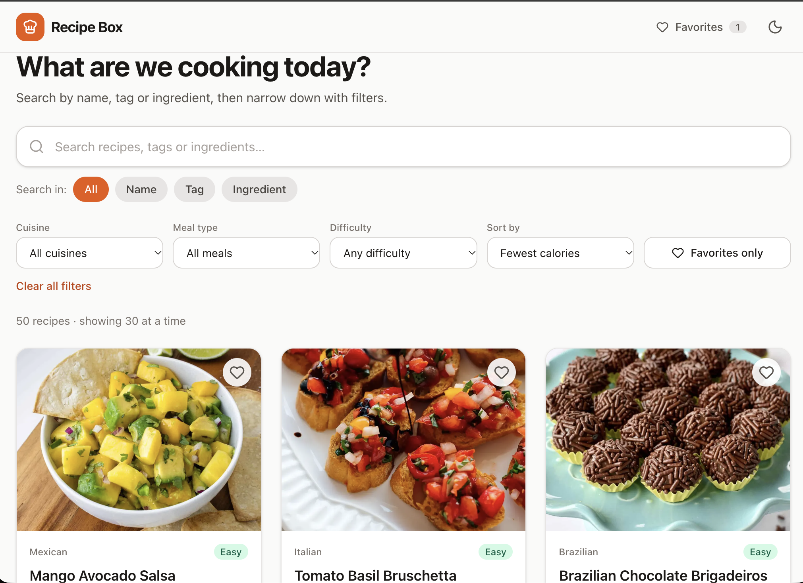
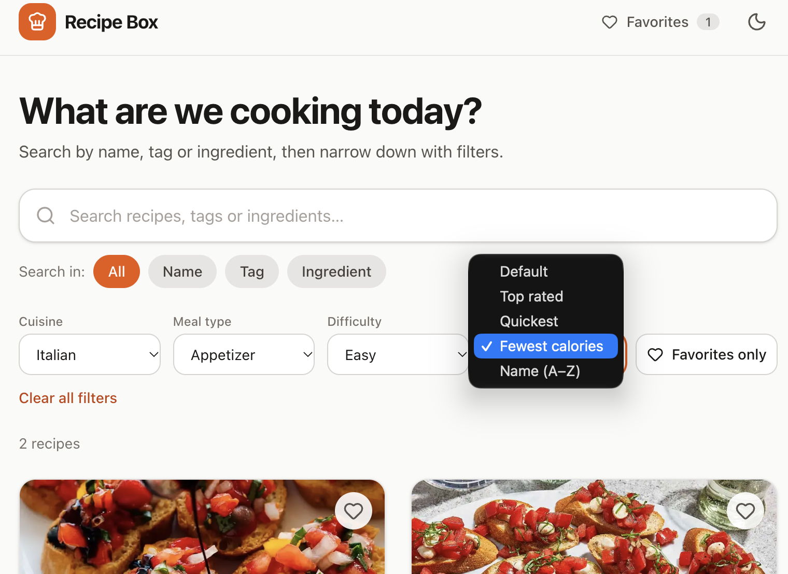
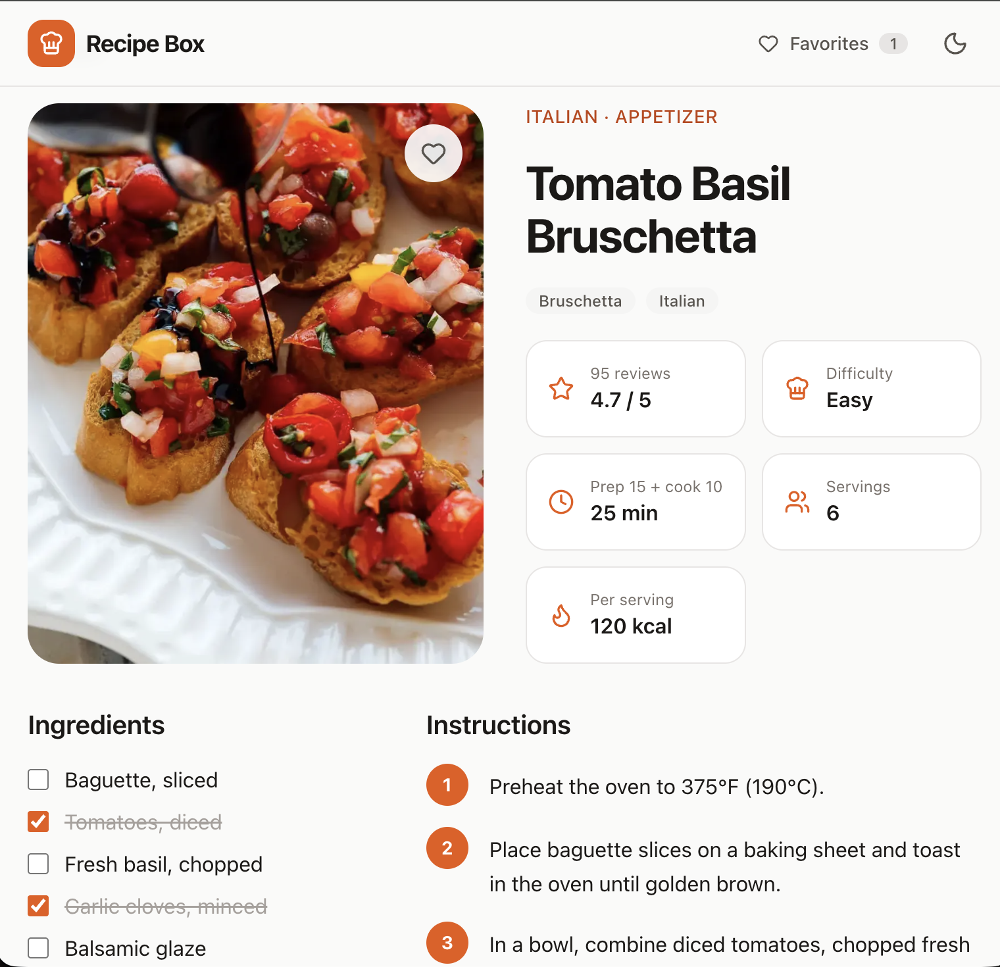

# Recipe Box

A fast, responsive recipe browser that helps people **find something to cook** from a catalogue of recipes, whether they know the dish name, a dietary tag, or only the ingredients in their fridge. Data comes from the free [DummyJSON Recipes API](https://dummyjson.com/docs/recipes).



## What the app helps you do

- **Find recipes the way you think about food.** Search by recipe name (*pizza*), by tag (*dessert*, *vegetarian*) or by ingredient (*garlic*, *basil*), or search all three at once. Matches are highlighted, and cards show which ingredient matched.
- **Narrow down quickly.** Combine filters for cuisine, meal type and difficulty, and sort by top rated, quickest, fewest calories or A–Z.

  

- **Browse without clicking through pages.** 30 recipe cards load first, and more appear as you scroll.
- **Cook from the recipe page.** See rating, difficulty, prep and cook time, servings and calories per serving. Tick off ingredients as you gather them and follow the numbered steps.

  

- **Save and share.** Heart recipes to build a favorites list (kept in your browser). Every search and filter is stored in the URL, so you can bookmark or share the exact results you are looking at.
- **Use it anywhere.** Responsive layout, light and dark themes, keyboard-accessible controls, and clear loading, empty and error states.

## Tech stack

| Area | Technology |
| --- | --- |
| UI | **React 19**, **TypeScript** (strict) |
| Build tooling | **Vite 8** |
| Styling | **Tailwind CSS 4** (CSS-first config, dark mode variant) |
| Data fetching & caching | **TanStack Query** |
| Routing | **React Router** (route-level code splitting, URL-synced filters) |
| Icons | **lucide-react** |
| Testing | **Vitest**, **React Testing Library**, jsdom |
| Linting | **oxlint** |
| Data source | [DummyJSON Recipes API](https://dummyjson.com/docs/recipes) |
| Hosting | **Cloudflare Pages** |

## Design notes

- The API holds only 50 recipes and supports name search only, so the full list is fetched **once** (`?limit=0`) and cached. Tag and ingredient search and all filter combinations are pure client-side functions in [`src/lib/filterRecipes.ts`](src/lib/filterRecipes.ts), covered by unit tests.
- Infinite scroll uses an `IntersectionObserver` to reveal results 30 at a time.
- Favorites and theme use `useSyncExternalStore` backed by `localStorage`; a small inline script in `index.html` applies the theme before first paint to avoid a flash.
- The recipe page reads from the cached list and falls back to `/recipes/:id` for direct links.
- Route-level code splitting keeps the home bundle small (~100 kB gzip).

## Getting started

```bash
npm install
npm run dev      # start dev server
npm test         # unit + component tests
npm run lint     # oxlint
npm run build    # typecheck + production build to dist/
npm run preview  # preview the build
```

## Deploy to Cloudflare

The app is a static SPA served with Cloudflare Workers static assets. [`wrangler.jsonc`](wrangler.jsonc) points at `dist/` and sets `not_found_handling: "single-page-application"`, so deep links such as `/recipe/5` fall back to `index.html` (no `_redirects` file needed).

| Setting | Value |
| --- | --- |
| Build command | `npm run build` |
| Deploy command | `npx wrangler deploy` |
| Environment variable | `NODE_VERSION=22` (optional) |
